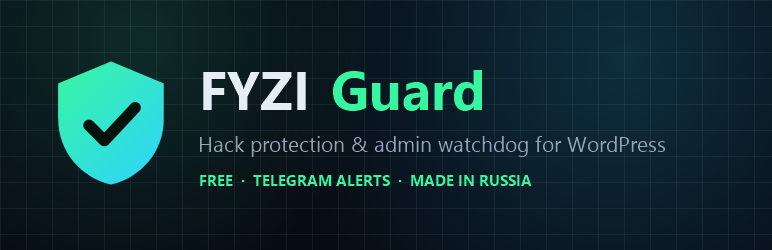

<p align="center"></p>

# FYZI Guard

Бесплатный плагин защиты WordPress от массовых взломов. Закрывает каналы, через которые сейчас взламывают сайты на WordPress, следит за администраторами и файлами и за несколько минут сообщает в Telegram, если происходит что-то подозрительное.

Плагин сделали специалисты [FYZI Shield](https://fyzi.ru/), которые каждый день чистят взломанные сайты, и закрывает он именно то, что встречается на практике.

**[⬇ Скачать последнюю версию](https://github.com/simonovnikita9/fyzi-guard/releases/latest/download/fyzi-guard.zip)** · WordPress 5.8+ · PHP 7.4+ · интерфейс на русском и английском

## Что умеет

### Защита

- Блокирует анонимные REST batch-запросы (`/wp-json/batch/v1`), через которые боты создают поддельных администраторов.
- Скрывает логины пользователей: `/wp-json/wp/v2/users`, `?author=` и карту сайта пользователей.
- Отключает XML-RPC — основной канал подбора паролей.
- Отключает редактор файлов тем и плагинов в админке.
- Ограничивает число попыток входа с одного IP.
- В один клик запрещает выполнение PHP в папке загрузок (Apache) или выдаёт готовое правило для nginx.
- Скрывает версию WordPress.

Каждую меру можно выключить отдельно.

### Мониторинг

- Следит за администраторами прямо в базе данных, поэтому замечает учётки, добавленные в обход WordPress, и администраторов, скрытых вредоносным кодом из списка пользователей.
- Сообщает о новых паролях приложений у администраторов.
- Каждый день сверяет файлы ядра WordPress с контрольными суммами wordpress.org и находит лишние PHP-файлы в ядре.
- Находит PHP-файлы в папке загрузок и PHP-код, спрятанный в картинках.
- Отслеживает новые и изменённые PHP-файлы в плагинах, темах и mu-plugins и проверяет их на типичные вредоносные конструкции.
- Напоминает об устаревших плагинах и других слабых местах.

### Уведомления

На e-mail и в ваш собственный Telegram-бот. Пошаговая настройка — внутри плагина.

## Установка

1. Скачайте [`fyzi-guard.zip`](https://github.com/simonovnikita9/fyzi-guard/releases/latest/download/fyzi-guard.zip) со страницы релизов.
   Кнопка «Code → Download ZIP» не подойдёт: в ней лишние папки, WordPress такой архив не установит.
2. В админке WordPress: «Плагины → Добавить новый → Загрузить плагин», выберите архив и активируйте.
   Администраторы, которые есть на момент активации, запоминаются как известные.
3. Откройте пункт меню «FYZI Guard» и нажмите «Проверить сейчас».
4. На вкладке «Уведомления» подключите Telegram.

## Приватность

Плагин работает полностью на вашем сайте и никуда не отправляет данные о нём. Он обращается только к двум внешним сервисам:

- **api.wordpress.org** — скачивает эталонные контрольные суммы ядра. Передаются только версия WordPress и язык.
- **api.telegram.org** — только если вы включили уведомления в Telegram и указали токен своего бота. Отправляется текст уведомления и домен сайта.

## Частые вопросы

**Может ли плагин сломать сайт?** Каждую меру защиты можно выключить на вкладке «Защита». Пароли приложений по умолчанию не отключаются — они нужны некоторым интеграциям.

**Можно вместе с Wordfence или другим плагином безопасности?** Да, функции почти не пересекаются. Если другой плагин уже ограничивает попытки входа, выключите эту функцию в FYZI Guard.

**Пришло уведомление о новом администраторе, но он мой.** Нажмите «Это мой администратор» рядом с пользователем на вкладке «Обзор».

## Если сайт уже взломан

Плагин защищает и предупреждает, но не лечит. Если сайт уже заражён, редиректит на казино или попал под санкции поисковиков — в [FYZI Shield](https://fyzi.ru/) есть срочная чистка и платная подписка с круглосуточным внешним мониторингом. Бесплатный плагин полностью работает и без неё.

## Для разработчиков

```
fyzi-guard/      сам плагин (то, что попадает в zip)
tests/run.php    функциональные тесты: wp eval-file tests/run.php — только на тестовой копии WordPress!
tools/i18n.js    сборка .pot/.po/.mo из tools/ru.json (каждую новую строку добавлять туда)
wporg-assets/    иконки и баннеры для каталога wordpress.org
```

## Лицензия

[GPL-2.0-or-later](LICENSE), как и сам WordPress.
